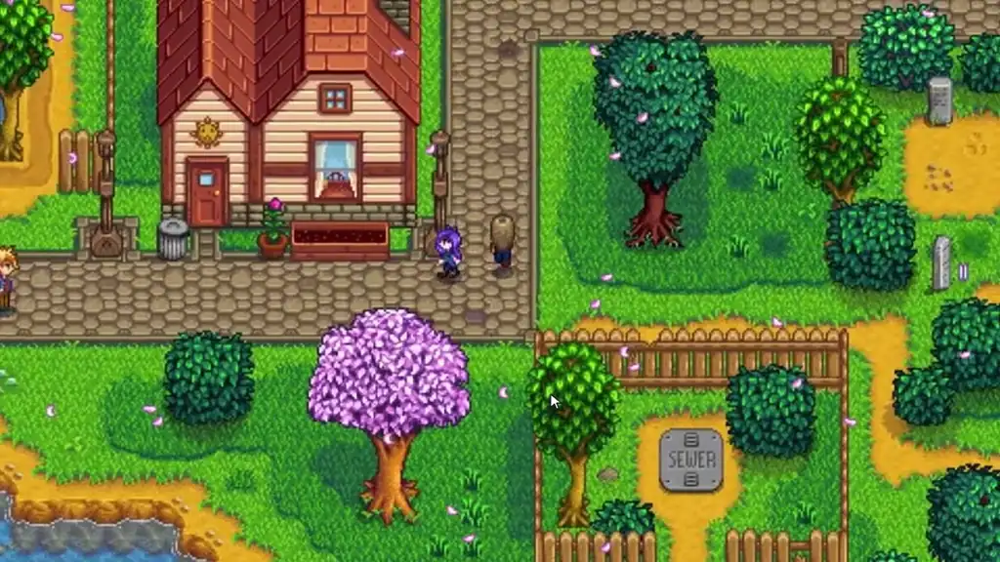
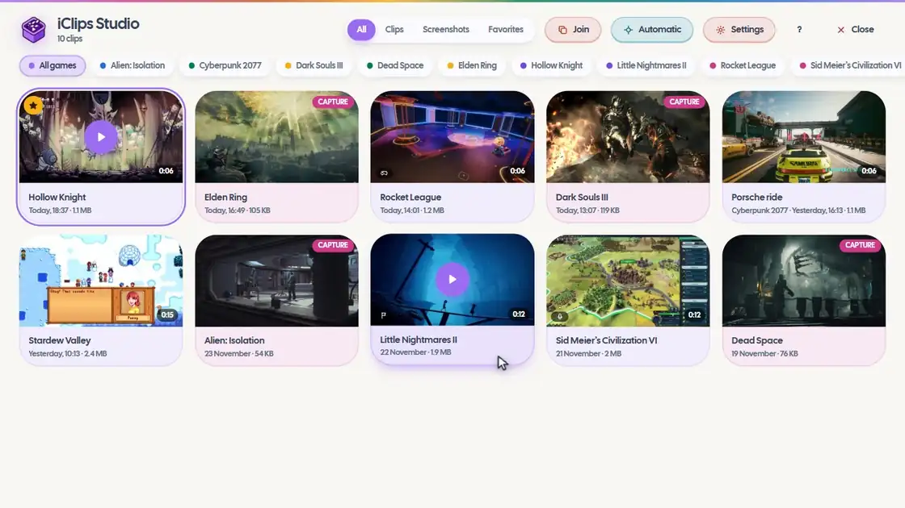

<div align="center">


# iClips

### Le studio de vos clips de jeu.

Gardez les dernières secondes de votre partie sans la quitter. Dites « Clip ça ! », coupez, passez en vertical, et glissez le clip dans Discord. Tout se passe sur votre PC.

<a href="https://github.com/atzski/ibox/releases/latest"><strong>Installer iBox</strong></a> · puis <strong>Paramètres › Plugins › iClips</strong>

<sub>Pas d'iBox ? <a href="https://github.com/atzski/iclips/releases/latest">Téléchargez l'app autonome</a> pour Windows.</sub>

Windows 10 et 11 · Gratuit et open source · Un plugin pour <a href="https://github.com/atzski/ibox">iBox</a> · <a href="https://atzski.github.io/ibox/iclips.html">Essayer la démo</a>

<sub><a href="README.md">English</a> · Français</sub>

<br>


</div>

## Garder le moment, en pleine partie

Votre PC garde en mémoire les dernières secondes de votre partie, 30 par défaut et jusqu'à deux minutes. Appuyez sur le raccourci de l'overlay d'iBox (**Alt+X**), ou maintenez **Vue + X** sur une manette : le panneau d'iClips glisse par-dessus le jeu.

<p align="center">
  
</p>

- **Gardez le clip** d'une pression, donnez-lui un titre, étoilez-le.
- **Gardez une capture.** Le panneau fige l'image du jeu à son ouverture : une pression de plus et elle rejoint vos captures.
- **Jamais dans vos clips.** Le panneau et les notifications d'iBox restent hors de la capture.
- **Clavier ou manette.** Tout se fait aux flèches et à Entrée, ou à la croix et A/B.

## « Clip ça ! »

Rien à ouvrir : dites **« Clip ça ! »**, maintenez **Vue + A**, ou laissez la fin de partie garder le dernier moment. Une notification avec la jaquette du jeu et un bruit d'obturateur vous disent que le clip est gardé.

La phrase est reconnue par Windows, hors ligne, sur votre PC : rien n'est envoyé ni enregistré. Le micro n'est écouté que pendant vos parties, et chacun des trois déclencheurs se coupe dans le Studio, sous **Automatique**.

## Monter sans quitter le Studio

<p align="center">
  
</p>

Vos originaux ne changent jamais : chaque montage crée un nouveau clip.

- **Couper** un clip avec deux poignées, sur la bande d'images ou avec I et O.
- **Assembler** plusieurs clips, dans l'ordre où vous les choisissez.
- **GIF** de 10 secondes au plus.
- **Vertical** 9:16 pour TikTok, Shorts et Reels : glissez le cadre sur ce qui compte.
- **Son** : montez ou baissez le jeu et le micro, séparément quand le clip les garde sur des pistes séparées.

Chaque bouton affiche son raccourci, et **?** les liste tous.

## Le partager

- **Glissez** un clip dans Discord, un dossier ou un navigateur.
- **Copiez-le**, puis collez-le avec Ctrl+V.
- **Un lien de 72 heures**, copié dès qu'il est prêt, à coller où vous voulez, ou envoyé à un ami iBox en message privé.
- **Enregistrez** une copie où vous voulez.

## Confidentialité

Les clips restent sur votre PC. Seul un clip que vous choisissez de partager par un lien le quitte : il part chez Litterbox, un hébergeur tiers gratuit, pour 72 heures.

Avant l'installation, iBox liste exactement ce que le plugin a le droit de faire :

- lire, renommer et supprimer vos clips vidéo ;
- garder les dernières secondes de vos parties en clip ;
- créer de nouveaux clips à partir des vôtres (coupe, assemblage, GIF) ;
- régler la capture des clips : qualité, durée, son de Windows et micro, leurs volumes et les pistes séparées ;
- partager vos clips : les copier, les glisser vers une autre application, en enregistrer une copie, créer un lien de 72 h chez Litterbox et l'envoyer à un ami ;
- garder un clip quand vous dites « Clip ça ! », à la manette ou en fin de partie (micro écouté seulement pendant vos parties, sur ce PC ; désactivable) ;
- afficher un panneau par-dessus vos jeux ;
- lire la manette pour ouvrir et piloter son panneau.

Chaque paquet est signé par son éditeur, et iBox vérifie la signature avant toute installation. Un plugin désactivé ne réserve aucun raccourci et n'ouvre aucune fenêtre.

## Sans iBox : l'app autonome

Vous n'utilisez pas iBox ? iClips existe aussi en petite application Windows : le même Studio, le même panneau, le même « Clip ça ! ».

1. Téléchargez `iClips_<version>_x64-setup.exe` depuis la [dernière version](https://github.com/atzski/iclips/releases/latest) et lancez-le.
2. L'app attend dans la zone de notification et garde les dernières secondes pendant que vous jouez. **Alt+X**, ou **Vue + X** maintenus sur une manette, ouvre le panneau par-dessus le jeu.
3. Cliquez sur l'icône pour ouvrir le Studio. Ses réglages contiennent le raccourci du panneau et le dossier des clips (`Vidéos\iClips` par défaut).

Les amis et la Communauté vivent dans iBox : l'app autonome partage en glissant, en copiant et par des liens. Si iBox tourne en même temps avec le plugin, les deux veulent Alt+X : choisissez un autre raccourci dans l'un des deux.

|  | Plugin iBox | App autonome |
|---|---|---|
| Installation | iBox › Paramètres › Plugins | Installeur des Releases |
| S'ouvre avec | Le raccourci de l'overlay d'iBox, Vue + X | Alt+X (réglable), Vue + X |
| Vit dans | iBox | La zone de notification |
| Envoi à un ami | Oui, par iBox | Non |

## Développement

```
npm install
npm run dev      # aperçu du Studio avec des clips d'exemple : http://localhost:5173/studio.html
npm test
PACK_LOCAL=1 npm run pack   # paquet signé + dist/catalog.json pour IBOX_PLUGINS_CATALOG
```

`npm run release` publie (Release GitHub et catalogue iNetbox) : sur demande explicite seulement. Le plugin demande iBox 1.0.8 ou plus récent.

`node scripts/icon.mjs "<logo>.png"` refait `icon.png` et `logo.png` (fond transparent) depuis le logo source.

Les fichiers de `ui/src/ibox/` sont des copies d'iBox (couleurs, ressorts, police Cal Sans) : les recopier quand iBox les change.

L'app autonome vit dans `app/` (Tauri 2) : voir [app/README.md](app/README.md). Conception et étapes : [docs/CONCEPTION.md](docs/CONCEPTION.md).

<sub>Les animations ci-dessus sont filmées sur la <a href="https://atzski.github.io/ibox/iclips.html">démonstration du site</a>, qui fait tourner le vrai Studio et le vrai panneau sur des séquences tirées des bandes-annonces des fiches Steam, propriété de leurs éditeurs. Par <a href="https://github.com/atzski">atzski</a>.</sub>
