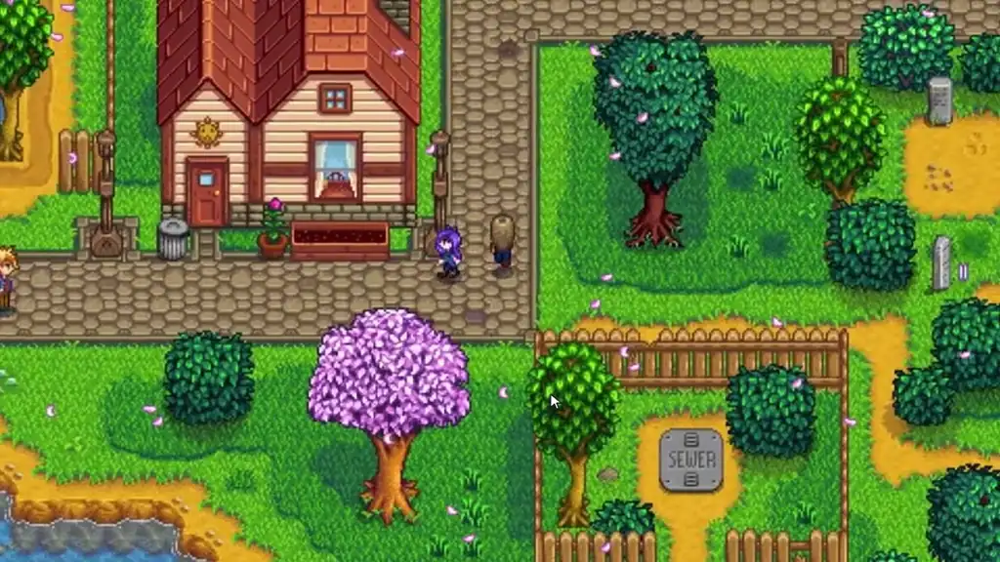
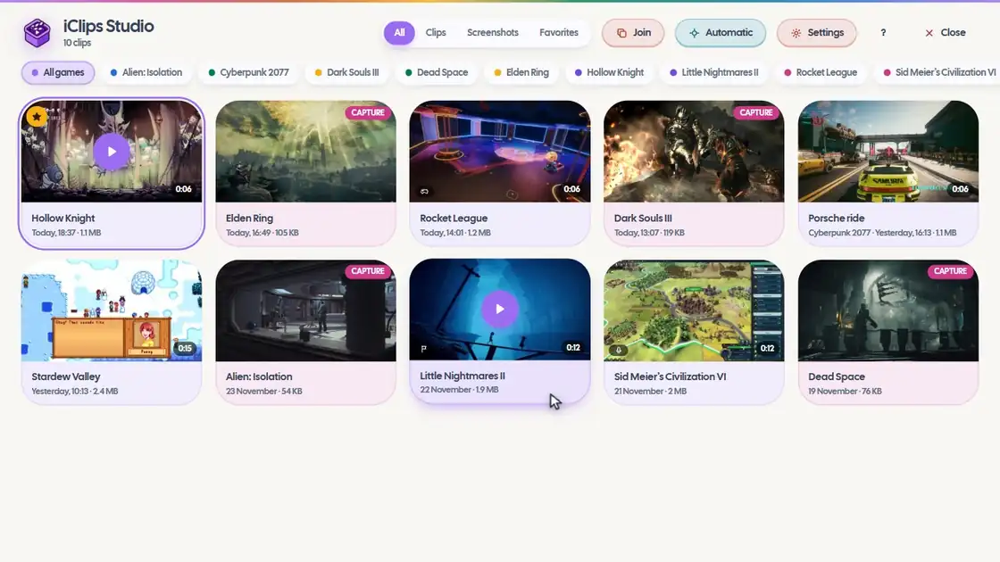

<div align="center">


# iClips

### The studio for your game clips.

Keep the last seconds of your game without leaving it. Say "Clip that!", trim, go vertical, and drop the clip into Discord. Everything happens on your PC.

<a href="https://github.com/atzski/ibox/releases/latest"><strong>Get iBox</strong></a> · then <strong>Settings › Plugins › iClips</strong>

<sub>No iBox? <a href="https://github.com/atzski/iclips/releases/latest">Download the standalone app</a> for Windows.</sub>

Windows 10 and 11 · Free and open source · A plugin for <a href="https://github.com/atzski/ibox">iBox</a> · <a href="https://atzski.github.io/ibox/iclips-en.html">Try the demo</a>

<sub>English · <a href="README.fr.md">Français</a></sub>

<br>


</div>

## Keep the moment, mid-game

Your PC keeps the last seconds of your game in memory, 30 by default and up to two minutes. Press iBox's overlay shortcut (**Alt+X**), or hold **View + X** on a controller: the iClips panel slides in over the game.

<p align="center">
  
</p>

- **Keep the clip** in one press, give it a title, star it.
- **Keep a screenshot.** The panel freezes the game's image as it opens: one more press and it joins your screenshots.
- **Never in your clips.** The panel and iBox's notifications are left out of the capture.
- **Keyboard or controller.** Everything works with the arrows and Enter, or with the D-pad and A/B.

## "Clip that!"

No need to open anything: say **"Clip that!"**, hold **View + A**, or let the end of the game keep the last moment. A notification with the game's cover and a shutter sound tell you the clip is kept.

The phrase is recognised by Windows, offline, on your PC: nothing is sent or recorded. The microphone is only heard during your games, and each of the three triggers can be turned off in the Studio, under **Automatic**.

## Edit without leaving the Studio

<p align="center">
  
</p>

Your originals never change: every edit makes a new clip.

- **Trim** a clip with two handles, on the image strip or with I and O.
- **Join** several clips, in the order you pick them.
- **GIF** of up to 10 seconds.
- **Vertical** 9:16 for TikTok, Shorts and Reels: drag the frame onto what matters.
- **Sound**: turn the game and the microphone up or down, separately when the clip keeps them on separate tracks.

Every button shows its shortcut, and **?** lists them all.

## Share it

- **Drag** a clip into Discord, a folder or a browser.
- **Copy** it, then paste it with Ctrl+V.
- **A 72-hour link**, copied as soon as it is ready, to paste anywhere, or sent to an iBox friend as a private message.
- **Save as…** a copy wherever you want.

## Private by design

Clips stay on your PC. The only thing that leaves it is a clip you choose to share as a link: it goes to Litterbox, a free third-party host, for 72 hours.

Before installing, iBox lists exactly what the plugin is allowed to do:

- read, rename and delete your video clips;
- keep the last seconds of your games as a clip;
- make new clips from yours (trim, join, GIF);
- set up clip capture: quality, length, Windows sound and microphone, their volumes and separate tracks;
- share your clips: copy them, drag them to another app, save a copy, make a 72-hour link on Litterbox and send it to a friend;
- keep a clip when you say "Clip that!", from the controller or when a game ends (microphone heard only during your games, on this PC; can be turned off);
- show a panel over your games;
- read the controller to open and drive its panel.

Every package is signed by its publisher, and iBox checks the signature before installing anything. A disabled plugin reserves no shortcut and opens no window.

## Without iBox: the standalone app

Don't use iBox? iClips also exists as a small Windows app of its own: the same Studio, the same panel, the same "Clip that!".

1. Download `iClips_<version>_x64-setup.exe` from the [latest release](https://github.com/atzski/iclips/releases/latest) and run it.
2. The app waits in the notification area and keeps the last seconds while you play. **Alt+X**, or **View + X** held on a controller, opens the panel over your game.
3. Click the tray icon to open the Studio. Its settings hold the panel shortcut and the clips folder (`Videos\iClips` by default).

Friends and the Community live in iBox: the standalone app shares by dragging, copying and links. If iBox runs with the plugin at the same time, both want Alt+X: pick another shortcut in one of them.

|  | iBox plugin | Standalone app |
|---|---|---|
| Install | iBox › Settings › Plugins | Installer from the Releases |
| Opens with | iBox's overlay shortcut, View + X | Alt+X (can be changed), View + X |
| Lives in | iBox | The notification area |
| Send to a friend | Yes, through iBox | No |

## Development

```
npm install
npm run dev      # Studio preview with sample clips: http://localhost:5173/studio.html
npm test
PACK_LOCAL=1 npm run pack   # signed package + dist/catalog.json for IBOX_PLUGINS_CATALOG
```

`npm run release` publishes (GitHub Release and iNetbox catalog): on explicit request only. The plugin needs iBox 1.0.8 or later.

`node scripts/icon.mjs "<logo>.png"` rebuilds `icon.png` and `logo.png` (transparent background) from the source logo.

The files in `ui/src/ibox/` are copies from iBox (colours, springs, Cal Sans font): copy them again when iBox changes them.

The standalone app lives in `app/` (Tauri 2): see [app/README.md](app/README.md). Design and milestones: [docs/CONCEPTION.md](docs/CONCEPTION.md).

<sub>The animations above are filmed on the <a href="https://atzski.github.io/ibox/iclips-en.html">site's demo</a>, which runs the real Studio and panel with footage from the trailers on the games' Steam pages, property of their publishers. Made by <a href="https://github.com/atzski">atzski</a>.</sub>
